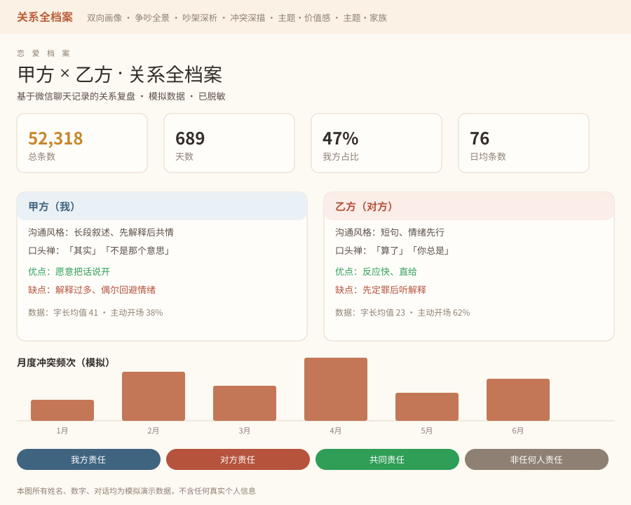
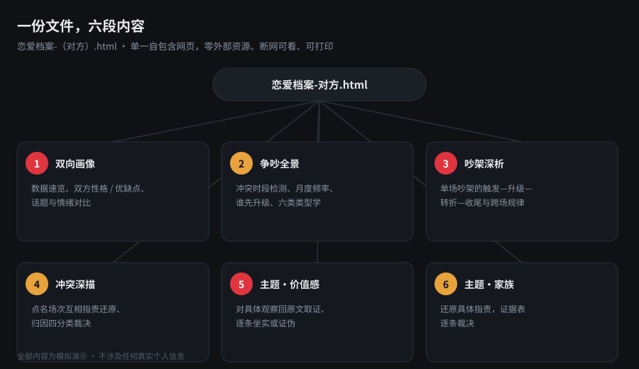
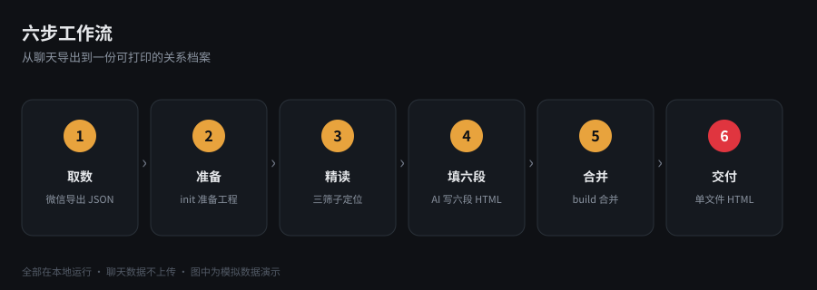

# love-archive-dossier

微信聊天记录 → **一份《恋爱档案》HTML**。单一自包含网页，零外部资源、断网可看、可打印。

> ⚠️ 本工具在**本地**处理你的聊天记录，不会上传任何数据。产出为明文私密文件，请勿随意分享。

## 预览



## 这是什么

把一段关系（你 × 对方）的微信聊天记录，做成一份**关系全档案**：双向画像、争吵全景、逐场深析、冲突深描、主题深描，全部合订进同一个 HTML 文件。



## 快速开始

```bash
# 1) 准备工程：写 config、跑指标、跑冲突检测、生成 6 段草稿
python scripts/solo_pipeline.py init \
    -e "聊天记录.json" -m "我" -o "对方" -w "./work_demo" --title "我 × 对方"

# 2) （AI 阶段）按 references/archive-schema.md 填充
#    1_双向画像.html … 6_主题_家族.html

# 3) 合并成单一 HTML（唯一交付物）
python scripts/solo_pipeline.py build -w "./work_demo"
# → work_demo/恋爱档案-对方.html
```

## 工作流



## 六段结构

| 段 | 文件 | 内容 |
|---|---|---|
| 1 | `1_双向画像.html` | 双向用户画像（锐评版） |
| 2 | `2_争吵全景.html` | 关键争吵·全景与类型学 |
| 3 | `3_吵架深析.html` | 关键吵架深度分析 |
| 4 | `4_冲突深描.html` | 关键冲突事件深描 |
| 5 | `5_主题_价值感.html` | 主题深描·价值感/物化/既要又要/道德绑架 |
| 6 | `6_主题_家族.html` | 主题深描·家族与指责辩析 |

## 安装（WorkBuddy）

将本仓库复制到用户级技能目录即可启用：

```bash
# Windows
xcopy /E love-archive-dossier %USERPROFILE%\.workbuddy\skills\love-archive-dossier\
# macOS / Linux
cp -r love-archive-dossier ~/.workbuddy/skills/love-archive-dossier
```

## 目录

```
love-archive-dossier/
├── SKILL.md / README.md / LICENSE
├── config.example.toml / dossier.example.toml
├── scripts/   (collect / detect_conflicts / merge_dossier / solo_pipeline)
├── references/(archive-schema / deep-analysis / reading-method / pitfalls)
└── assets/    (preview / workflow / structure 讲解图)
```

## 写作纪律（硬性）

平视 · 证据挂回 · 双向裁决 · 诚实三件事 · 归因四分类（末类「不是任何人的责任」必填）· 不站队不定罪 · 私密内容勿外传。

## 隐私说明

- 所有分析在本地完成，聊天数据不会被上传或外发。
- 脚本默认开启 `strict_parties`，只保留你 / 对方 / 系统 三方，自动剔除合并转发里的第三方噪声。
- 导出的聊天记录（`.json`）已列入 `.gitignore`，请勿误提交真实对话。
